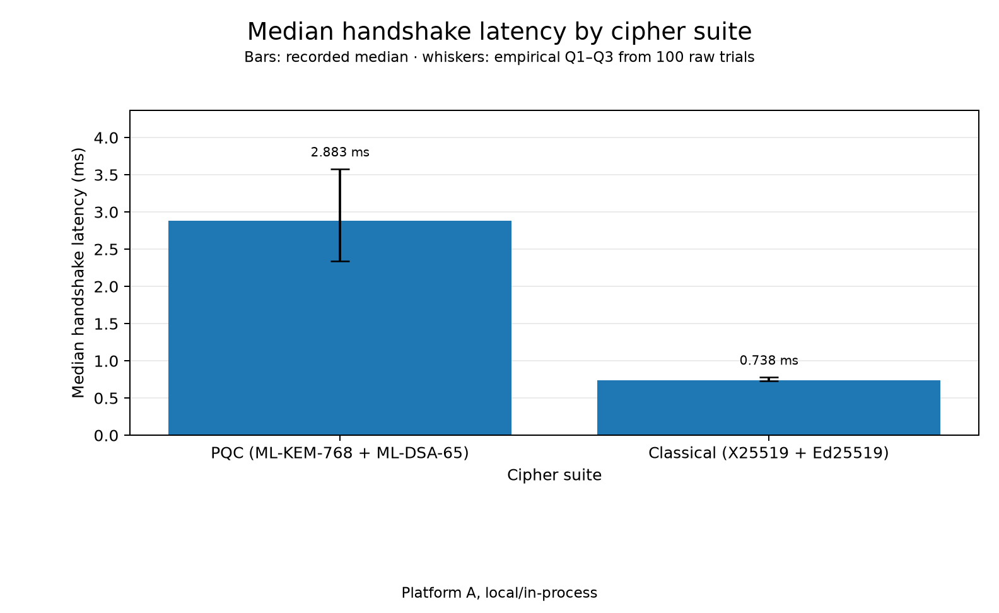
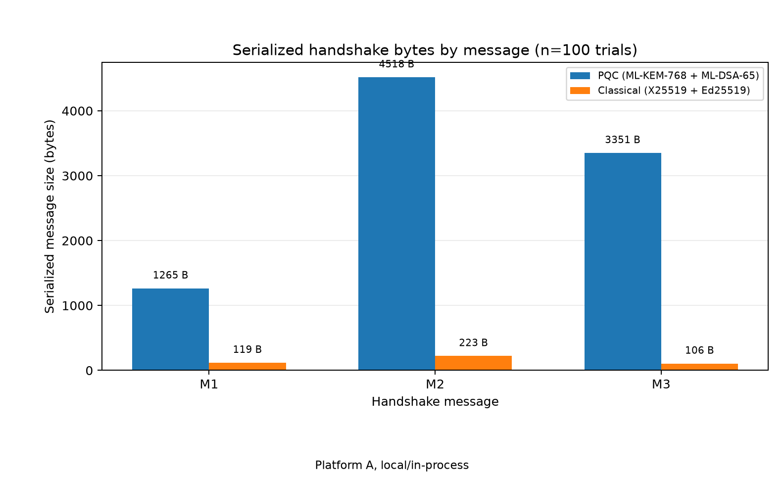
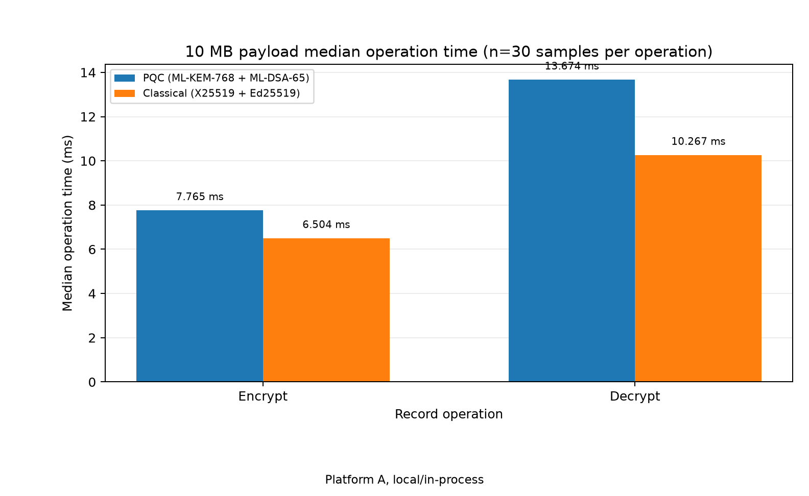

# QFF 2026 PS-P1 — Technical Report

**Task:** PS-P1 — Quantum-Safe Secure Communication Channel (Phase 2)
**Repo:** `Devo982/SRM-Qiskit-FF-PS-P1` · **Track:** 5 — Post-Quantum Cryptography
**Platform of record:** Intel Mac (x86_64 native), macOS 15.8.2, CPython 3.13.17,
`cryptography==50.0.2` (kit pin; see `platform_A_info.json` for the recorded
install origin). **Supported Python:** 3.13 only. The recorded Platform A run used CPython 3.13.17.

---

## 1. Executive summary

This document specifies and evaluates the quantum-safe secure channel built for
PS-P1 Phase 2. The system is a single handshake-and-record state machine
instantiated by two cipher suites: `QFF26-PQC-1` (ML-KEM-768 + ML-DSA-65) and
`QFF26-CLASSICAL-1` (X25519 + Ed25519 as a classical baseline). Both suites share
one wire format, one HKDF-SHA256 key schedule with client-to-server and
server-to-client chains derived independently, and one AES-256-GCM record layer.
Suite selection is a local policy decision on each endpoint; it is never
negotiated on the wire.

Security is evaluated by a 27-check fault-injection battery (T1–T9), executed
twice — once per suite — for 54/54 passing checks. Every fault is injected on the
bytes between two real endpoints, so every mutation travels the real parse,
policy, trust-store, signature, and key-confirmation path. The battery asserts
via public confirmation status only (states, failure categories, payload sizes);
key material never appears in logs or assertions.

In the 29 October 2026 Platform A run `20261029T211325Z`, the full handshake
median was 2.883 ms for QFF26-PQC-1 and 0.738 ms for QFF26-CLASSICAL-1, from
100 successful handshakes per suite. Their IQRs were 1.236 ms and 0.048 ms;
p95 values were 5.186 ms and 0.885 ms. The measured serialized handshake totals
were 9,134 B and 448 B, respectively. In the separate payload benchmark, 10 MB
end-to-end throughput was 481.85/504.18 MiB/s (client-to-server/server-to-client)
for PQC and 558.61/556.22 MiB/s for the classical baseline. Median 10 MB
per-call encryption/decryption times were 7.765455/13.673712 ms for PQC and
6.504431/10.266675 ms for the classical baseline. Both suites have 32 B of
transmitted record overhead. All measurements are local and in-process, not
network results. The associated environment metadata was generated at
`2026-10-29T21:13:19+00:00` and records `on_battery=false`. This is a competition
prototype: Section 7 states the assumptions and limitations explicitly.

## 2. Deliverable-to-requirement map

| PS-P1 requirement | Realization in this repo |
|---|---|
| Authenticated key exchange with PQ KEM + PQ signatures | Suite `QFF26-PQC-1`, `protocol/channels.py` |
| Classical baseline for comparison | Suite `QFF26-CLASSICAL-1` |
| HKDF-SHA256, direction-separated, explicit | `protocol/keyschedule.py` (vetted `cryptography` HKDF API; RFC 5869 vectors and independent-oracle regression checks) |
| AES-256-GCM record layer with replay defense | `protocol/records.py` |
| T1–T9 automated security tests → organizer summary + detailed evidence | `tests/run_security_tests.py` → `results/security_tests.csv` (nine-row organizer summary) and `results/security_tests_detailed.csv` (54 individual checks) |
| 3 official payloads (1 KB / 100 KB / 10 MB) with SHA-256 | `data/payloads/payload_sha256.txt` (manifest committed; `*.bin` regenerated locally) |
| Benchmarks, ≥10 successful handshakes, median/IQR/p95, measured message sizes, payload timings/overhead | `bench/bench_handshake.py`, `bench/bench_payload.py` → `results/tables/handshake_results.csv`, `bench_handshake.csv`, `payload_results.csv`, `bench_payload.csv` |
| UX layer with zero key contact | `cli/adapter.py` + invariants I1–I5 in `docs/INTEGRATION_CONTRACT.md` |
| Reproducible judge path | README setup and quickstart; security battery (54/54) and regression commands |

## 3. Protocol design (v2)

### 3.1 Design principles

**P1 — One state machine, two suites.** Client: `INIT → M1_SENT → M3_SENT →
ESTABLISHED → CLOSED | FAILED`; Server: `INIT → M2_SENT → ESTABLISHED →
CLOSED | FAILED`. The suite parameterizes cryptography only; every state
transition, check, and failure path is identical for both suites, so the fault
matrix exercises the same logic twice.

**P2 — Suites are local policy, never negotiated.** Each endpoint is configured
with a suite id and an allow-list. A suite id received on the wire that is not
known, or not in the local allow-list, raises `PolicyViolation` *before any
cryptographic operation runs* (T9a). A server echo that differs from the
client's locally-chosen suite is rejected by the client (T9b); there is no
downgrade or fallback path anywhere in the code.

**P3 — Direction-separated key chains.** `c2s_key` and `s2c_key` are independent
HKDF-Expand outputs with distinct labels; likewise the two 12-byte nonce bases.
A key (or nonce) used in one direction is never reused in the other.

**P4 — UX layer has zero key contact.** The CLI façade passes identity names,
payload bytes, and public confirmation status only (invariants I1–I5 in
`docs/INTEGRATION_CONTRACT.md`): no key bytes cross the façade, private material
lives only in git-ignored `identities/`, all protocol access goes through the
façade, logs carry metadata only, and there is no insecure mode.

**P5 — Typed failures, fail closed.** Every rejection is one of eight typed
errors (Section 4.3). `on_frame()` converts any unexpected exception into a
generic `ChannelError` failure and wipes session secrets: the pump never crashes
and never fails open.

**P6 — Faults are injected on the wire.** `protocol/wire.py` carries serialized
frames between two real endpoints; fault hooks mutate, duplicate, substitute, or
splice frames at a per-direction frame index before delivery. No test reaches
into channel internals to simulate an attack.

### 3.2 Suite registry

| Suite id | KEM | pk / ct (B) | Signature | sig (B) | Handshake nonce |
|---|---|---|---|---|---|
| `QFF26-PQC-1` | ML-KEM-768 | 1184 / 1088 | ML-DSA-65 | 3309 | 32 B |
| `QFF26-CLASSICAL-1` | X25519 (KEM-shaped) | 32 / 32 | Ed25519 | 64 | 32 B |

Both suites share: HKDF-SHA256 key schedule, AES-256-GCM record layer, 32-byte
handshake nonces, and identical transcript/signing conventions.

*X25519 as a KEM.* To reuse one state machine, the classical suite models
Diffie–Hellman in the KEM's shape: the responder generates a fresh ephemeral
X25519 keypair, derives `ss = ECDH(eph_sk_S, kem_pk_C)`, and sends its ephemeral
public key as the "ciphertext" (32 B). The initiator decapsulates with
`ss = ECDH(kem_sk_C, eph_pk_S)`. Both sides contribute fresh ephemerals, so the
classical path has forward secrecy equal to ephemeral–ephemeral ECDH. In the PQC
suite the initiator generates a fresh ML-KEM-768 keypair per session; the
identity key only ever signs transcripts.

*Signature context domain separation.* `cryptography` 50.x ML-DSA/Ed25519 APIs
expose no context parameter, so signatures are computed over
`len(ctx) u16 BE || ctx || message` with `ctx ∈ {QFF26-P1-srv, QFF26-P1-cli}` —
a server signature can never be replayed as a client signature or vice versa
(the role-swap check in T7a is additionally enforced by the trust store).

### 3.3 Wire format

A handshake frame is an ordered sequence of TLV records `(tag:1B)(len:4B BE)(value)`.
Parsing is strict: exact expected tags in fixed order, no missing fields, no
duplicates, no trailing bytes; violations raise `TranscriptBindingError`.

| Tag | Field | Tag | Field |
|---|---|---|---|
| 0x01 | proto_version (= 0x02) | 0x07 | kem_ct |
| 0x02 | suite_id | 0x08 | nonce_S |
| 0x03 | id_C | 0x09 | sig_S |
| 0x04 | kem_pk_C | 0x0A | sig_C |
| 0x05 | nonce_C | 0x0B | fin_S |
| 0x06 | id_S | 0x0C | fin_C |

Message schemas (fixed order):

- **M1** (client → server): `proto_version, suite_id, id_C, kem_pk_C, nonce_C`
- **M2** (server → client): `proto_version, suite_id, id_S, kem_ct, nonce_S, sig_S, fin_S`
- **M3** (client → server): `sig_C, fin_C`

Serialized handshake sizes were measured from the actual M1, M2 and M3
frames captured in `InMemoryWire.log` during 100 successful handshakes per
suite. The lengths below were stable across all measured runs; these are
observed serialized frame sizes, not estimates computed from cryptographic
parameter constants.

| Suite | M1 | M2 | M3 | Total |
|---|---|---|---|---|
| `QFF26-PQC-1` | 1265 B | 4518 B | 3351 B | 9134 B |
| `QFF26-CLASSICAL-1` | 119 B | 223 B | 106 B | 448 B |

The measured serialized handshake-size ratio is about 20.4×
(9,134 B versus 448 B). Both ML-KEM-768 and ML-DSA-65 are NIST security
category 3 parameter sets (FIPS 203 and FIPS 204). The byte ratio describes
message sizes, not a ratio of cryptographic security strength.
References: https://csrc.nist.gov/pubs/fips/203/final and
https://csrc.nist.gov/pubs/fips/204/final.

### 3.4 Handshake flow and transcript binding

```
Client                                         Server
  ---- M1: ver,suite,id_C,kem_pk_C,nonce_C ---->
  (fresh KEM keypair per session)
                                               policy: version + suite (allow-list)
                                               trust lookup (id_C, role=client)
                                               freshness cache (id_C, nonce_C)   [T8c]
                                               encapsulate -> ss, kem_ct
  <---- M2: ver,suite,id_S,kem_ct,nonce_S,
           sig_S,fin_S --------------------
                                               sig_S = Sign_S(CTX_SERVER, T2)
                                               T2 = M1(as received) || M2-core
  strict parse; policy on version+echoed suite
  trust lookup (id_S, role=server)
  length checks vs suite parameters
  T2 = M1(as sent) || M2-core(rebuilt)
  verify sig_S over T2                         fin_S = HMAC(fk, FIN_S_LABEL || TH2)
  T3 = T2 || TLV(09,sig_S); TH2 = H(TH2_LABEL || T3)
  ss = decapsulate(kem_sk_C, kem_ct)
  fk = HKDF(salt=TH2, ikm=ss, info="QFF26-P1 fin", 32)
  verify fin_S (constant time)
  sig_C = Sign_C(CTX_CLIENT, T3)
  TH3 = H(TH3_LABEL || T3 || TLV(0A,sig_C))
  fin_C = HMAC(fk, FIN_C_LABEL || TH3)
  ---- M3: sig_C,fin_C ------------------------>
                                               trust lookup AGAIN (role=client)
                                               verify sig_C over T3
                                               verify fin_C
                                               TH4 = H(TH4_LABEL || T3 || TLV(0A,sig_C) || TLV(0C,fin_C))
                                               traffic keys = HKDF(salt=TH2, ikm=ss, info=label || TH4)
  ESTABLISHED                                  ESTABLISHED
```

Key properties:

1. **Transcript-bound signatures.** The server signs `T2 = M1-exactly-as-received
   || M2-core`; the client rebuilds the same `T2` from `M1-exactly-as-sent` and the
   received M2 core before verifying. Any single-bit change anywhere in M1 or the
   M2 core breaks the signature or the shared secret (T2 battery, T7b splice).
2. **Key confirmation both ways.** `fin_S` binds `TH2` (through the client's M1 and
   the server's M2), `fin_C` binds `TH3` (which additionally covers `sig_C`). Both
   are verified with `hmac.compare_digest` before `ESTABLISHED` is entered.
3. **Verification order is fixed** on every authenticated input:
   `policy → trust-store lookup → signature → Finished`. The trust store is the
   only source of verification keys — there is no code path that consumes a
   verification key from the wire, so an attacker cannot substitute one (T6).
   On the client, the server's signature is verified **before** the ML-KEM
   decapsulation: the trusted key and the complete signed transcript are both
   available at that point, so a failed verification never touches key
   derivation. The server necessarily encapsulates before the client is
   authenticated (M2 must precede M3); its acceptance of cryptographic state
   is still gated on the full chain at M3. Neither endpoint reaches
   `ESTABLISHED` before `policy → lookup → signature → Finished` has succeeded
   end to end, and any verification failure wipes all transient secrets
   before the state becomes `FAILED` (verified line-by-line against
   `protocol/channels.py`: client `proto_version → suite policy → trust lookup →
   length checks → sig_S → decapsulate → fin_S → ESTABLISHED`; server M3:
   `trust lookup → sig_C → fin_C → ESTABLISHED`).
4. **The server re-checks the trust store at M3**, so a client identity revoked
   mid-handshake cannot complete (design v2 §4).
5. **Freshness cache, honestly scoped.** The server keeps an LRU cache
   (TTL 300 s, 4096 entries) of `(id_C, nonce_C)` pairs and raises
   `HandshakeReplayDetected` on an M1 replay (T8c). This is DoS hygiene and early
   rejection; it is *not* the correctness anchor — full handshake replay (T8b)
   is rejected by transcript binding at M3 regardless of cache state.

### 3.5 Key schedule

All key derivation uses the vetted `cryptography` HKDF (RFC 5869) and HMAC
primitives — there is no hand-rolled crypto anywhere in the schedule, and the
labels below are the only design-specific input. `PRK =
HKDF-Extract(salt = TH2, IKM = ss)` is performed inside the library's HKDF and
never materialized: every expansion is expressed as
`HKDF(salt = TH2, ikm = ss, info = <label> ‖ <context>, len)`, which is
byte-identical to Extract followed by Expand with the same salt/IKM/info.
Correctness and output compatibility are pinned by `tests/test_regressions.py`:
RFC 5869 Appendix A test vectors (A.1, A.3) plus an independent-oracle
cross-check over every QFF26 label (100 randomized trials). The derivation
order is fixed and acyclic:

```
ss -> sig_S -> TH2 -> PRK -> fk -> fin_S -> sig_C -> TH3 -> fin_C -> TH4
     -> c2s_key / s2c_key / nb_c2s / nb_s2c / exporter
```

| Value | Derivation |
|---|---|
| `TH2` | `SHA-256("QFF26-P1-TH2" ‖ T3)` |
| `PRK` | `HKDF-Extract(salt = TH2, IKM = ss)` (inside the library; not materialized) |
| `fk` | `HKDF(salt = TH2, ikm = ss, info = "QFF26-P1 fin", 32)` |
| `fin_S` | `HMAC-SHA256(fk, "QFF26-P1 fin-S" ‖ TH2)` |
| `fin_C` | `HMAC-SHA256(fk, "QFF26-P1 fin-C" ‖ TH3)` |
| `c2s_key` | `HKDF(salt = TH2, ikm = ss, info = "QFF26-P1 c2s" ‖ TH4, 32)` |
| `s2c_key` | `HKDF(salt = TH2, ikm = ss, info = "QFF26-P1 s2c" ‖ TH4, 32)` |
| `nb_c2s` / `nb_s2c` | `HKDF(salt = TH2, ikm = ss, info = "QFF26-P1 nb c2s"/"QFF26-P1 nb s2c" ‖ TH4, 12)` |
| `exporter` | `HKDF(salt = TH2, ikm = ss, info = "QFF26-P1 export" ‖ TH4, 32)` |

The kit quickstart labels (`QFF26 c2s` / `QFF26 s2c`) are preserved and
strengthened with `TH4` transcript binding: the traffic keys do not exist until
both Finished values have been committed to the transcript. Transient secrets
(`ss`, `fk`, KEM private key) are wiped from the channel object on
`ESTABLISHED` and on every terminal state (best-effort; see Section 7).

### 3.6 Record layer

Header (16 B, always used as AAD):

```
version u16 (0x0001) | type u8 (0x01 app-data, 0x02 close)
| dir u8 (0x01 c2s, 0x02 s2c) | seq u64 BE | ct_len u32 BE
```

- `nonce (12 B) = nb_dir XOR (seq as u64 BE, left-padded to 12 B)` — injective in
  `seq`; with a per-direction base, nonce reuse is structurally excluded.
- Per-record wire overhead: **32 B** (16 B header + 16 B GCM tag). One record per
  payload; no chunking in scope (Section 7).
- Receiver pipeline order is fixed: length/`ct_len` consistency → record version
  → direction byte (`TranscriptBindingError` on mismatch) → **sliding replay
  window eligibility check (read-only, before any decryption)** → AES-256-GCM
  open (`InvalidTag` → `RecordAuthenticationError`) → **window state commit
  (only after successful authentication)**.
- **Replay window:** per-direction watermark + 64-bit bitmap, split into a
  read-only `check(seq)` and a `commit(seq)` that mutates state only after GCM
  authentication succeeds. `seq < watermark` or a duplicate inside the window →
  `RecordReplayDetected` *before* GCM runs; a forward gap ≥ 64 advances the
  watermark **at commit time**, so a forged record with an invalid tag can
  never consume sequence numbers or advance the window (regression-tested in
  `tests/test_regressions.py`). GCM authenticates integrity, not freshness —
  the window is the replay defense, and T8a verifies it (first copy delivered,
  byte-identical second copy rejected).
- **Session caps:** sender-side cap `max_records` (default 2^40, configurable) and
  hard sequence cap 2^63; exceeding raises `SessionExhausted`. Renegotiation is a
  fresh handshake (documented, not automated — Section 7).
- **Authenticated close:** `close()` emits a type-0x02 record under the send key;
  a forged close fails GCM authentication and never tears down the peer (T1c).

## 4. Security model

### 4.1 Trust model
The protocol authenticates each identity by looking up its verification keys in the trust store supplied to the channel. Each entry associates the identity with an expected role (`client` or `server`) and suite-specific verification keys. The repository includes the committed root `trust_store.json` as a public-only reference trust-store artifact. For reproducible local tests and the in-process CLI demo, `scripts/provision_identities.py` creates local Alice/Bob signing key pairs under git-ignored `identities/` and writes their matching public verification keys to `identities/trust_store.test.json`. The security launcher, test runner and CLI demo use this generated test trust store; local provisioning does not modify the committed root file.

The generated test trust store is a local test fixture derived from the corresponding local test identities. It is not an independently authenticated production trust bootstrap. A real deployment must distribute and pin verification keys through an authenticated out-of-band mechanism, with suitable rotation and revocation procedures.

**Authentication is MUTUAL:** the server signs the handshake transcript (`sig_S`) and the client also signs the transcript (`sig_C`); neither endpoint is treated as server-authenticated-only, and both signature checks are verified by the peer.

Private keys live only in git-ignored `identities/alice.json` and `identities/bob.json` (ML-DSA-65 stored as its 32-byte seed, restored via `from_seed_bytes`; Ed25519 as raw 32 bytes).
### 4.2 Attacker capabilities considered

The battery models an active attacker with full control of the wire: bit flips
in any handshake field or record byte, substitution of whole fields (rogue
identity, rogue suite id), replay of records, of full old sessions, and of M1,
splicing of a genuine old signature into a fresh session, role swap with genuine
keys, and a rogue endpoint with its own (valid) keypair.

Threat mapping: a **man-in-the-middle (MITM)** attempting to impersonate a peer
is stopped by pinned identity lookup and role/transcript binding (T6 and T7);
**record and handshake replay** are stopped by the pre-decryption record window
and the handshake freshness/transcript checks (T8a–T8c); and a **downgrade**
attempt is stopped by local suite policy, rejection of unknown suites, and the
client's no-fallback check for a substituted suite echo (T9a–T9b). These are
specific prototype tests, not a claim that all deployment-level MITM, replay, or
downgrade risks have been eliminated.

### 4.3 Failure taxonomy (typed, fail closed)

| Category | Meaning | Fired by (observed) |
|---|---|---|
| `PolicyViolation` | version/suite rejected before any crypto | T2 (proto_version, suite_id), T9a, T9b |
| `UntrustedIdentity` | identity not pinned, or role mismatch | T2 (id_C, id_S), T6, T7a |
| `AuthenticationFailure` | signature or Finished verification failed | T2 (kem_pk_C, nonce_C, kem_ct, nonce_S), T3, T7b, T8b |
| `TranscriptBindingError` | strict-parse violation, KEM input reject, record direction mismatch | T5 (header_direction) |
| `HandshakeReplayDetected` | (id_C, nonce_C) freshness cache hit | T8c |
| `RecordReplayDetected` | stale/duplicate seq, rejected before decrypt | T8a |
| `RecordAuthenticationError` | GCM `InvalidTag` wrapped at the record boundary, or structural header/length rejection | T4, T5 (`gcm_tag`, `header_aad`, `header_version`) |
| `SessionExhausted` | record/sequence cap reached | documented; not fault-injected |

## 5. T1–T9 wire-level security battery

### 5.1 Methodology

`protocol/wire.py` delivers frames between two real `ClientChannel` /
`ServerChannel` instances. Fault hooks are registered per direction and frame
index (c2s #0 = M1, #1 = M3, #2+ = app records; s2c #0 = M2, #1+ = app records)
and can flip a byte, duplicate, substitute, or splice frames. Assertions use
public confirmation status only: channel state, `failure_category`, delivery
flags, and payload equality — never key bytes. The matrix comprises 27 checks per suite × 2 suites = 54 detailed checks. The
nine-row organizer-format summary is written to `results/security_tests.csv`; the
individual checks are retained in `results/security_tests_detailed.csv`. Beyond the battery, `tests/test_regressions.py`
pins the key schedule to the RFC 5869 Appendix A test vectors and an
independent oracle, and regression-tests the replay window's
commit-after-authentication rule (a forged far-ahead-sequence record must not
mutate window state).

### 5.2 Results (both suites pass identically — 54/54)

| ID | Scenario (all injected on the wire) | Expected | Observed | PQC-1 | CLASSICAL-1 |
|---|---|---|---|---|---|
| T1a | honest handshake | both ESTABLISHED | both ESTABLISHED | PASS | PASS |
| T1b | 3 official payloads × both directions, byte + SHA-256 vs `payload_sha256.txt` | 6/6 verified | 6/6 verified | PASS | PASS |
| T1c | authenticated close | peer CLOSED | server CLOSED | PASS | PASS |
| T2 | bit-flip kem_pk_C / nonce_C | client aborts, keys never established | `AuthenticationFailure`, established=False | PASS | PASS |
| T2 | bit-flip id_C / id_S | abort at trust lookup | `UntrustedIdentity` | PASS | PASS |
| T2 | bit-flip proto_version / suite_id | policy reject before crypto | `PolicyViolation` | PASS | PASS |
| T2 | bit-flip kem_ct / nonce_S | client aborts, keys never established | `AuthenticationFailure`, established=False | PASS | PASS |
| T3 | bit-flip sig_S / sig_C | verifier aborts | `AuthenticationFailure` | PASS | PASS |
| T4 | bit-flip record ciphertext | reject with AEAD authentication failure, plaintext withheld | `RecordAuthenticationError` wrapping `InvalidTag` (`__cause__` verified) | PASS | PASS |
| T5 | bit-flip GCM tag / authenticated header AAD (record type) / header version / header direction | reject, plaintext withheld | GCM tag and authenticated-header mutations: `RecordAuthenticationError` wrapping `InvalidTag`; version: structural `RecordAuthenticationError`; direction: `TranscriptBindingError` before AEAD | PASS | PASS |
| T6 | attacker identity + own valid key | reject at lookup, before signature math | `UntrustedIdentity` | PASS | PASS |
| T7a | role swap (server identity initiates as client) | reject at lookup | `UntrustedIdentity` | PASS | PASS |
| T7b | genuine old sig_S spliced into fresh session | transcript binding rejects | `AuthenticationFailure` | PASS | PASS |
| T8a | byte-identical app-record replay | first copy delivered; replay rejected before decrypt | `RecordReplayDetected`, first copy intact | PASS | PASS |
| T8b | full old-session replay | fails at M3 verification | `AuthenticationFailure` | PASS | PASS |
| T8c | M1 replay against freshness cache | early rejection | `HandshakeReplayDetected` | PASS | PASS |
| T9a | unknown suite_id | `PolicyViolation` before any crypto | `PolicyViolation` | PASS | PASS |
| T9b | M2 echoes a *different valid* suite | client local policy rejects, no fallback | `PolicyViolation`, established=False | PASS | PASS |

### 5.3 Where the guarantees bite

- **Bit-flips abort at the owning step.** Flips in bytes covered by a signature
  but not by the KEM surface as signature/Finished failures at the peer
  (`kem_pk_C`, `nonce_C`, `kem_ct`, `nonce_S` → client
  `AuthenticationFailure`); identity bytes are rejected by the trust store
  *before* signature math; policy bytes (version, suite) are rejected before any
  crypto at all. In every case traffic keys are never established.
- **Splicing fails on transcript binding (T7b).** A genuine `sig_S` from an old
  session signs a different `T2` (different M1 bytes, different nonces), so
  verification fails; the same transcript hash binds `fin_S`/`fin_C`.
- **Replay is a freshness property (T8).** A byte-identical record *does*
  authenticate under GCM — the sliding window rejects it before decryption, and
  the first copy is delivered exactly once. Full-session replay fails at M3
  because the server's fresh ephemeral KEM output makes the old transcript
  inconsistent.

## 6. Benchmarks

### 6.1 Methodology

- **Handshake latency** (`bench/bench_handshake.py --runs 100`): 100 attempts
  per suite using fresh channel objects for every attempt. Suite signing keys and
  the matching ephemeral trust store are created once per benchmark invocation;
  the handshake protocol performs the KEM exchange for each session. Timing
  covers the full `run_handshake` call over the synchronous in-process wire.
  The script records median, IQR (Q75−Q25), linearly interpolated p95, minimum,
  maximum, successes and failures. No warm-up trial is discarded.
- **Handshake byte counts** are measured from the actual delivered frames in
  `InMemoryWire.log`: c2s frame 0 is M1, s2c frame 0 is M2, and c2s frame 1 is
  M3. Directional and total counts are sums of these captured frame lengths.
- **Payload measurements** (`bench/bench_payload.py --repeats 15`) use the three
  official SHAKE-256 payloads. For each payload and suite, the script performs
  a crypto-timing pass with 15 transfers in each direction, giving 30 samples
  for encryption and 30 for decryption, then a separate end-to-end throughput
  pass with the original record functions restored. Every received payload is
  compared byte-for-byte and checked against its official SHA-256 digest.
- **Units and scope:** throughput is MiB/s (bytes divided by 1024²). All results
  are local/in-process measurements; no socket or real-network latency is
  measured. Timing includes Python-level call and serialization work in the
  stated measurement path, not just native AES-GCM instructions.

### 6.2 Handshake latency and serialized sizes (100 attempts per suite)

| Suite | Trials | Success / failure | Median | IQR | p95 | Min | Max | c2s bytes | s2c bytes | Total bytes |
|---|---:|---:|---:|---:|---:|---:|---:|---:|---:|---:|
| `QFF26-PQC-1` | 100 | 100 / 0 | 2.883 ms | 1.236 ms | 5.186 ms | 1.830 ms | 7.466 ms | 4616 | 4518 | 9134 |
| `QFF26-CLASSICAL-1` | 100 | 100 / 0 | 0.738 ms | 0.048 ms | 0.885 ms | 0.707 ms | 2.805 ms | 225 | 223 | 448 |

Measured individual frame lengths:

| Suite | M1, client → server | M2, server → client | M3, client → server | Check: sum |
|---|---:|---:|---:|---:|
| `QFF26-PQC-1` | 1265 B | 4518 B | 3351 B | 9134 B |
| `QFF26-CLASSICAL-1` | 119 B | 223 B | 106 B | 448 B |

The directional totals are M1 + M3 for client-to-server and M2 for
server-to-client. Raw evidence: `results/tables/handshake_results.csv` (organizer
columns) and `results/tables/bench_handshake.csv` (includes the M1/M2/M3 breakdown
and min/max). The recorded run ID is `20261029T211325Z`. The raw file
`results/tables/handshake_raw_samples.csv` contains 100 successful timings per suite
(200 data rows total). The latency figure is generated from these samples and uses
empirical Q1–Q3 error bars; reported medians/IQR/p95 are read from the organizer CSV.





### 6.3 Payload encryption/decryption and record overhead

The `trials` field in `payload_results.csv` is 30 samples per operation: 15
client-to-server and 15 server-to-client. `ciphertext_bytes` in these results is
the full captured serialized record frame (header + encrypted payload + GCM tag);
`overhead_bytes` is serialized frame length minus plaintext length.

| Suite | Payload | Plaintext bytes | Serialized `ciphertext_bytes` | Transmitted overhead | Trials per operation | Median encrypt | Median decrypt | SHA-256 |
|---|---|---:|---:|---:|---:|---:|---:|---|
| PQC | 1 KB | 1024 | 1056 | 32 B | 30 | 0.009570 ms | 0.010812 ms | Match |
| PQC | 100 KB | 102400 | 102432 | 32 B | 30 | 0.042872 ms | 0.100847 ms | Match |
| PQC | 10 MB | 10485760 | 10485792 | 32 B | 30 | 7.765455 ms | 13.673712 ms | Match |
| Classical | 1 KB | 1024 | 1056 | 32 B | 30 | 0.010516 ms | 0.011709 ms | Match |
| Classical | 100 KB | 102400 | 102432 | 32 B | 30 | 0.052332 ms | 0.110774 ms | Match |
| Classical | 10 MB | 10485760 | 10485792 | 32 B | 30 | 6.504431 ms | 10.266675 ms | Match |

**Overhead accounting:** the protocol components are a 12 B derived nonce,
a 16 B header and a 16 B GCM tag: 44 B combined component accounting. The nonce
is derived from the nonce base and sequence number and is not transmitted.
Therefore the actual serialized frame overhead is 32 B (16 B header + 16 B
tag). The organizer-format `overhead_bytes` field records measured transmitted
overhead (serialized frame length minus plaintext length); the 12 B derived
nonce is reported separately and is not counted as an on-wire byte.

Raw data in the organizer's column layout: `results/tables/payload_results.csv`.



### 6.4 End-to-end payload throughput (median of 15 transfers per direction, MiB/s)

| Suite | Payload | Plaintext bytes | c2s MiB/s | s2c MiB/s |
|---|---|---:|---:|---:|
| `QFF26-PQC-1` | 1 KB | 1024 | 36.03 | 40.48 |
| `QFF26-PQC-1` | 100 KB | 102400 | 632.24 | 681.28 |
| `QFF26-PQC-1` | 10 MB | 10485760 | 481.85 | 504.18 |
| `QFF26-CLASSICAL-1` | 1 KB | 1024 | 34.76 | 36.98 |
| `QFF26-CLASSICAL-1` | 100 KB | 102400 | 620.48 | 653.84 |
| `QFF26-CLASSICAL-1` | 10 MB | 10485760 | 558.61 | 556.22 |

These throughput measurements use the uninstrumented end-to-end
`send → wire delivery → recv` path; the per-call timing wrappers are not active
during this pass. Raw data: `results/tables/bench_payload.csv` (column names
explicitly use MiB/s).

### 6.5 Interpretation and limitations

- **Handshake cost and size:** the current CSVs show a PQC median handshake
  about 3.9 times the classical baseline (2.883 ms versus 0.738 ms) and a total
  handshake about 20.4 times larger (9,134 B versus 448 B). The ML-KEM-768
  encapsulation material and ML-DSA-65 signatures account for most of the added
  handshake bytes. These are results from this implementation and Platform A,
  not universal performance guarantees.
- **Post-handshake record path:** both suites use the same AES-256-GCM record
  layer and have identical 32 B transmitted overhead (a 16 B header plus a 16 B
  GCM tag). The derived 12 B nonce is not transmitted. In the current
  `payload_results.csv`, 10 MB per-call median encrypt/decrypt times are
  7.765455/13.673712 ms for PQC and 6.504431/10.266675 ms for the classical
  baseline (30 samples per operation). Thus the per-call medians are higher for
  PQC in this run, by about 19.4% for encrypt and 33.2% for decrypt.
- **End-to-end throughput trade-off:** in `bench_payload.csv`, 10 MB throughput
  is 481.85 MiB/s client-to-server and 504.18 MiB/s server-to-client for PQC,
  compared with 558.61 and 556.22 MiB/s for the classical baseline. Relative to
  that baseline, PQC throughput is about 13.7% lower client-to-server and 9.4%
  lower server-to-client in this run. The per-call timing pass and separate
  uninstrumented end-to-end throughput pass measure different code paths, so
  their values should not be treated as interchangeable. These are local,
  run-specific observations, not a general performance prediction.
- **Small records:** the 32 B transmitted overhead is 3.125% of a 1 KB plaintext
  record, about 0.0313% of 100 KB and about 0.0003% of 10 MB. For a single-record
  payload, fixed per-call work and framing are proportionally more visible for
  small payloads. The implementation does not chunk or fragment a payload.
- **Timing interpretation:** no warm-up handshake is discarded, and all runs
  are local/in-process on one Intel Mac. The matching `platform_A_info.json` was
  generated at `2026-10-29T21:13:19+00:00` and records `on_battery=false`; the
  environment check therefore observed AC power at metadata collection time.
  This does not turn the measurements into network results or eliminate timing
  variability from process load, library initialization, buffer copies and
  runtime effects. The numbers should not be presented as network latency or an
  independent cryptographic audit.
## 7. Prototype status and assumptions

This is a competition prototype built in a 24-hour sprint, not a production
library. It has no formal security proof; the construction follows standard
authenticated-key-exchange patterns (SIGMA/TLS 1.3-style transcript-bound
signatures plus Finished key confirmation), and the implementation has not been
independently audited. Explicit assumptions and limitations:

1. **Trust store distribution and integrity are out of band.** The committed
   `trust_store.json` is a public-only reference artifact. Local tests and
   the CLI demo use the generated `identities/trust_store.test.json` matching
   their local test keys. A real deployment needs an independently authenticated
   trust-store distribution mechanism, revocation, and rotation (none implemented).
2. **The OS CSPRNG is trusted** (`os.urandom`, `cryptography` key generation).
3. **No side-channel hardening** beyond constant-time `hmac.compare_digest` and
   the library's native primitives. Python-level timing variance is possible.
4. **DoS resistance is out of scope.** The server does cheap unauthenticated
   work (fresh encapsulation) per M1 by design; the freshness cache (TTL 300 s,
   LRU 4096) is hygiene and early replay rejection, not a correctness anchor.
5. **Single trust domain.** No namespacing, delegation, or multi-tenant policy.
6. **Identity-key compromise** breaks future impersonation resistance but not
   past session confidentiality: every session uses a fresh KEM keypair, and
   traffic keys are erased from the channel object on terminal states.
7. **Zeroization is best-effort.** `bytearray` buffers are wiped, but Python's
   memory model cannot guarantee that key bytes never persist elsewhere.
8. **One record per payload; no chunking/fragmentation.** A single record is
   bounded by the u32 `ct_len` field and available memory; `SessionExhausted`
   ends the session at the configurable cap (default 2^40 records, hard cap
   2^63).
9. **In-process wire for tests and benchmarks.** Frames are identical to what a
   socket transport would carry; sockets, TLS-over-TLS comparisons, congestion,
   and OS effects are out of scope. Numbers are single-machine (Intel Mac) and
   not representative of network deployments.
10. **Auto-renegotiation after `SessionExhausted` is documented, not automated**;
    re-establishing is a fresh handshake by construction.
11. **X25519 is modeled as a KEM** (ephemeral–ephemeral ECDH) to keep one state
    machine across suites; the classical suite is a comparison baseline, not a
    recommended migration target for production post-quantum deployments.
12. **ML-DSA-65 identity files store the 32-byte seed** (restored via
    `from_seed_bytes` in `cryptography` 50.x). The seed is equivalent to the
    full private key and is protected accordingly (git-ignored `identities/`,
    never printed, never logged).
13. **Logs and test output carry metadata only** (states, categories, sizes);
    key bytes never appear on stdout, in CSVs, or in assertions.

## 8. Reproduction guide
Clean clone on Python 3.13. `requirements.txt` specifies direct dependencies;
`requirements-lock.txt` is generated from it and fixes resolved versions and hashes.
Install with the lock file. `cryptography==50.0.2` remains the exact organizer pin.

```bash
git clone https://github.com/Devo982/SRM-Qiskit-FF-PS-P1.git
cd SRM-Qiskit-FF-PS-P1

# Portable setup (Windows, macOS and Linux)
python -m venv .venv
# Windows PowerShell/cmd: run the Windows activation line below instead.
.venv\Scripts\activate
# macOS/Linux: run this line instead of the Windows activation line.
source .venv/bin/activate
python -m pip install -r requirements-lock.txt

python common/env_check.py              # -> READY - environment is correct.
python scripts/provision_identities.py  # creates identities/ + identities/trust_store.test.json; root trust_store.json is untouched
python -m tests.run_security_tests      # 54 detailed checks, all expected PASS
python -m tests.test_regressions        # RFC 5869 vectors + replay-window regression
python -m cli.demo --suite QFF26-PQC-1  # metadata-only end-to-end demo
python bench/bench_handshake.py --runs 100
python bench/bench_payload.py --repeats 15
python scripts/make_figures.py          # reads only results/tables/*.csv
```

`bench/bench_handshake.py --runs 100` writes `handshake_results.csv`,
`bench_handshake.csv`, and successful per-trial rows in
`handshake_raw_samples.csv`. `bench/bench_payload.py --repeats 15` writes
`payload_results.csv` and `bench_payload.csv`. `scripts/make_figures.py` reads
only CSVs under `results/tables/` and writes the three PNGs under
`results/figures/`. Run commands in this order on Platform A; all benchmark
measurements are local/in-process, not network measurements.

Expected artifacts after reproduction: `results/security_tests.csv`,
`results/security_tests_detailed.csv`, `results/tables/handshake_results.csv`,
`results/tables/bench_handshake.csv`, `results/tables/handshake_raw_samples.csv`,
`results/tables/payload_results.csv`, `results/tables/bench_payload.csv`, the
three PNGs under `results/figures/`, `data/payloads/payload_*.bin` and
`payload_sha256.txt` (payload binaries are generated locally and git-ignored),
and `platform_A_info.json`.

> **Windows activation:** the Windows line is `.venv\Scripts\activate`; do not
> run the Bash setup helper on Windows. On macOS/Linux use `source .venv/bin/activate`.
>
> **Intel macOS note.** `cryptography==50.0.2` is the fixed organizer pin. On
> Intel Macs pip may need a source build against local static OpenSSL; consult
> `scripts/QFF2026_intel_mac_env_setup.sh` and source `~/.qff26-openssl-env.sh`
> before installing if a compatible wheel is unavailable. The environment check
> records `install_origin` honestly in `platform_A_info.json`.

## 9. Recommendations and next improvements

1. **Evaluate a hybrid ML-KEM-768 + X25519 key exchange.** Combine the independent
   shared secrets with a reviewed, domain-separated combiner and test both classical
   and post-quantum failure behavior before changing the wire protocol.
2. **Automate rekey/renegotiation after `SessionExhausted`.** Define a state-machine
   transition, policy for outstanding records and failure recovery, and add explicit
   regression and wire-level tests before claiming automated rekeying.
3. **Run a real two-machine network test and measure Platforms B and D.** Record
   network transport, RTT, packet loss, hardware, software versions and repeated
   trials separately from the existing local/in-process Platform A CSVs.
4. **Improve key handling beyond best-effort zeroization.** Assess memory-safe native
   secret buffers or a suitable OS-backed key facility, document copies and lifetimes,
   and test destruction semantics; Python object wiping alone cannot guarantee erasure.
5. **Specify trust-store lifecycle.** Add authenticated distribution, versioning,
   rotation and revocation procedures, including what happens to active sessions when
   a peer identity is withdrawn.
6. **Treat handshake bytes as a priority for optimization.** The committed CSVs show
   a 20.4× total-handshake byte increase (9,134 B versus 448 B); ML-KEM-768 public
   key/ciphertext material and ML-DSA-65 signatures dominate that increase. Profile
   actual message components and consider protocol-level size changes only after a
   security review; the measured record-layer overhead is already the same 32 B in
   both suites.

This remains a competition prototype, **not production security**. These are
follow-up engineering recommendations, not claims that the listed improvements have
already been implemented or validated.

## 10. Artifact integrity

**Committed:** all source (`protocol/`, `tests/`, `cli/`, `bench/`, `scripts/`,
`common/`), `docs/INTEGRATION_CONTRACT.md`, this report, `README.md`,
`requirements.txt`, `requirements-lock.txt`, and the root
`trust_store.json` (public-only reference artifact), plus
`data/payloads/payload_sha256.txt`, `results/security_tests.csv`,
`results/security_tests_detailed.csv`, `results/tables/*.csv`,
`platform_A_info.json`.

**Never committed:** the entire `identities/` directory (local private
identity keys/seeds and generated public `trust_store.test.json`; enforced
by `.gitignore`), `data/payloads/*.bin` (regenerable from the deterministic
generator and verified against the committed SHA-256 manifest), virtualenvs
and caches.
